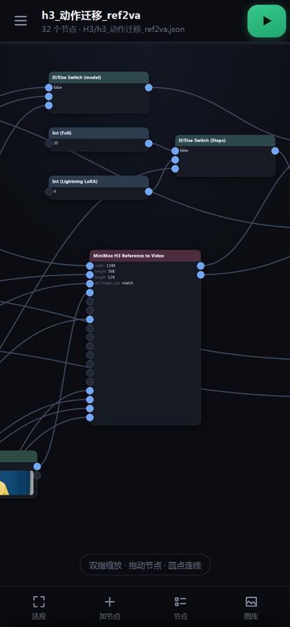
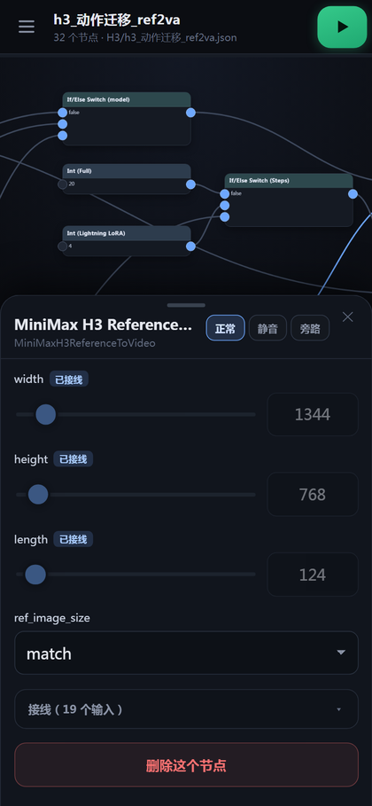
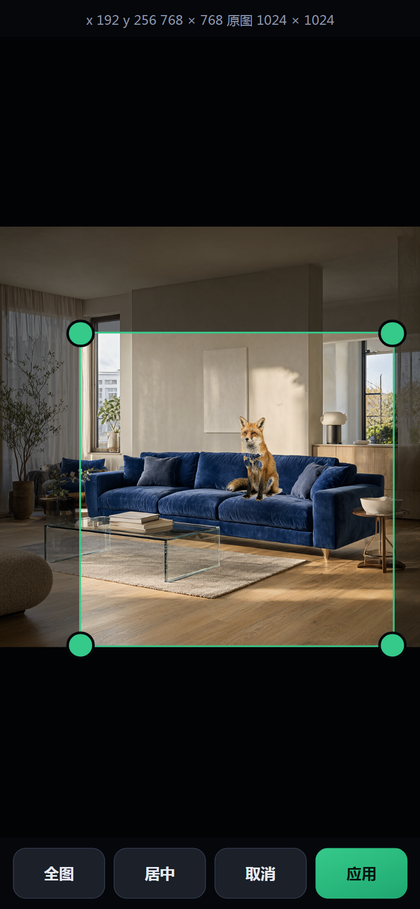
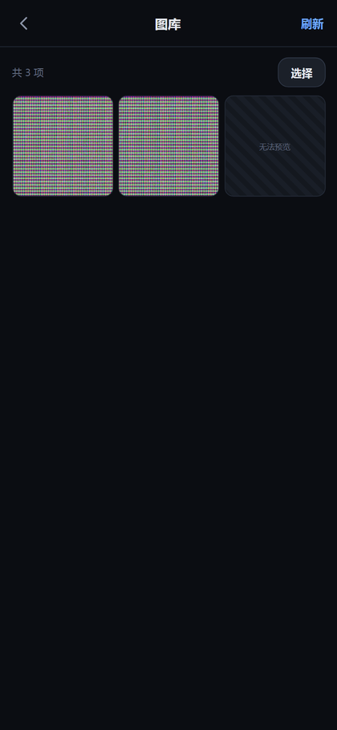

# ComfyUI Mobile UI · 手机端节点画布

给 ComfyUI 加一套**触摸优先**的节点界面。手机浏览器打开 `/mobile/` 就能看整张图、拖节点、连线、改参数、跑任务、看图存图 —— 不用在 6 寸屏上抠 1px 的圆点。

原生界面一行代码都不动，电脑端照旧用 `http://127.0.0.1:8188`。

> A touch-first web UI for ComfyUI. Open `/mobile/` on a phone to pan, zoom, wire, edit
> parameters, queue runs and browse outputs. The desktop UI is untouched — this is a
> separate page with its own routes, not injected JavaScript.

<p>
  
  
  
  
</p>

---

## 一、为什么需要它

ComfyUI 的原生前端是为鼠标和 27 寸显示器写的：连线端点是 10px 的圆、参数面板是三列、右键菜单是主要入口。缩小到手机上时，能看见图，但**没法编辑**。

这套界面不是"把桌面版缩小"，而是按触摸重新设计的第二套前端：

- **画布**：单指平移、双指缩放、按住节点拖动、从端口拖出连线
- **参数面板**：点节点从底部弹出，是所有编辑的主要入口
- **中文**：节点名、参数名都有中文标注（内置 80+ 常用节点类型 + 60+ 常用参数）

---

## 二、特性

| 能力 | 说明 |
|---|---|
| 触摸画布 | 平移 / 捏合缩放 / 拖节点 / 连线 / 点击选中 |
| 节点参数 | 滑块、数值、开关、下拉、多行文本、取色器 |
| 已接线提示 | 参数被上游接走时显示来源节点，提供「改成本机值」/「去改上游」 |
| 动态插槽 | `COMFY_AUTOGROW_V3`（如 H3 参考图 `ref_images`）可增删槽位 |
| 可视化框选 | 裁切类节点不再靠滑条猜 `x=192`，直接拖框，数字写回节点 |
| 图库 | 缩略图网格（服务端生成真缩略图，省 90%+ 流量）、多选删除（进回收站）、点开才加载原图 |
| 提示词词库 | 片段一键存、按**光标位置拼接插入**、分组与搜索；存在 `user/default/mobile_ui/prompts.json`，可手动编辑 |
| 上传图片 | `LoadImage` 类节点可直接从相册选图 |
| 队列 / 进度 | 右上角 ▶ 运行，再点中断；WebSocket 实时进度 |
| 返回键 | 逐层关闭：框选器 → 面板 → 参数面板 → 画布；在画布再按会先确认 |
| 节点操作 | 复制 / 重置 / 删除 / 静音 / 旁路 |
| 工作流 | 浏览、打开、另存副本到 `_mobile/` |

---

## 三、安装

### 1. 放进 custom_nodes

```bash
cd <ComfyUI>/custom_nodes
git clone https://github.com/raracannot/comfyui-mobile-ui.git mobile_ui
```

文件夹名建议就叫 `mobile_ui`（不必强制，但路径更直观）。

### 2. 让 ComfyUI 监听局域网

默认只绑 `127.0.0.1`，手机连不上。启动时加 `--listen`：

```bash
python main.py --listen 0.0.0.0 --port 8188
```

Windows 一键启动器（`run_nvidia_gpu.bat` 等）里把 `main.py` 那行改成上面这样即可。

### 3. 重启 ComfyUI，用手机打开

```
http://<电脑的局域网 IP>:8188/mobile/
```

不知道 IP？打开界面后 `☰ → 设置 → 手机访问地址` 会列出所有真实可用地址，点一下复制。

> 只想在电脑上用、不开放局域网也行：这时 `/mobile/` 只有本机能打开，功能完全一样。

---

## 四、配置

全部通过环境变量，可选：

| 变量 | 默认 | 作用 |
|---|---|---|
| `COMFYUI_MOBILE_TOKEN` | 空（不启用） | 设置后 `/mobile/` 需要 `?t=<token>` 才能打开，首次通过后写 cookie |
| `COMFYUI_MOBILE_DEBUG` | `1` | 调试通道（远端诊断用）。设为 `0` 彻底关闭 |

Windows 示例（在启动器里 `set` 后再启动）：

```bat
set COMFYUI_MOBILE_TOKEN=my-secret-123
python main.py --listen 0.0.0.0 --port 8188
```

> ⚠️ **令牌只保护这个界面本身，不保护 ComfyUI 的 API**。`/prompt`、`/view`、`/history`
> 仍然是裸的。要暴露到公网，请在前面加认证（Cloudflare Access、Caddy `basic_auth`、
> Nginx `auth_basic`），或者干脆用 Tailscale。详见「远程访问」。

---

## 五、手机上的操作

| 想做的事 | 怎么做 |
|---|---|
| 缩放 | 双指捏合 |
| 平移 | 单指在空白处拖 |
| 移动节点 | 按住节点的标题栏拖 |
| 调参数 | **点节点** → 底部弹出参数面板 |
| 看全图 | 底部 `适应` |
| 找节点 | 底部 `节点`（可搜标题 / 类型 / 参数值），点一下自动定位 |
| 连线 | 放大后从一个圆点拖到另一个圆点；**够不着时用面板里的「选择来源…」** |
| 断开连线 | 参数面板 → 接线 → 断开 |
| 加节点 | 底部 `加节点` → 搜类型 → 点选 |
| 跑 / 停 | 右上角 ▶（再点一次是中断） |
| 看图 / 存图 | 底部 `图库` → 点图 → `保存到本机` |
| 批量删图 | 图库 → `选择` → 点选或 `全选` → `删除所选`（**进回收站，可还原**） |
| 传参考图 | 点开 LoadImage 类节点 → `📷 从相册选择图片` |
| 框选裁切区域 | 裁切节点面板 → `🖼 可视化框选区域` |
| 加动态插槽 | 面板里 `＋ 添加一个` / `－ 去掉最后一个` |
| 静音 / 旁路 | 参数面板右上角 `正常 / 静音 / 旁路` |
| 另存一份 | `☰ → 工作流 → 把当前画布另存到 _mobile/` |
| 存一段提示词 | 文本节点面板 → `💾 存为片段`（自动命名，之后可在词库改名） |
| 用片段拼提示词 | 文本节点面板 → `📚 插入片段` → 点「插入」，会插到**光标处**，不会覆盖已有内容 |
| 管理词库 | 底部 `词库`：搜索、按分组筛选、编辑、删除 |

**参数面板是主要编辑入口**。画布上的节点只显示少量关键值，完整控件都在面板里——这是手机上唯一能舒服改参数的方式。

---

## 六、为什么它不会弄坏电脑版

这是设计时最优先的约束。具体做法：

| 风险点 | 处理方式 |
|---|---|
| 改核心文件 | 没有。全部代码在 `custom_nodes/mobile_ui/` 一个文件夹里 |
| 把 JS 注入原生界面 | **刻意不做**。自定义节点声明 `WEB_DIRECTORY` 会让 JS 注入**每一个**页面（含电脑端），一个语法错误就能让原生界面白屏。本插件不声明 |
| 路由冲突 | 全部挂在 `/mobile/` 下 |
| 启动期崩溃 | 路由注册整段 `try/except`，失败只写日志，ComfyUI 照常启动 |
| 覆盖你的工作流 | 只读你的文件；写入只允许进 `workflows/_mobile/`，且同名拒绝覆盖（409） |
| 路径穿越 | 所有读文件都做 `_confine()` 限定在 workflows 目录内，`../` 直接 400 |
| 端口 / 模型 / 配置 | 一个都不动 |

**回滚**：删掉 `custom_nodes/mobile_ui/` → 立刻回到原样。

---

## 七、远程访问（异地连家里的 ComfyUI）

### 推荐：Tailscale

手机和电脑装 Tailscale、登录同一账号，然后直接访问：

```
http://<电脑的 tailscale IP>:8188/mobile/
```

流量走 WireGuard 点对点加密，**不开任何公网端口**，也不需要域名和证书。这是最省事、最安全的方式。

### 备选：隧道 / 反向代理

页面已经为此预留好了能力：

1. **接口根路径自动推导** —— 从地址栏反推 API 位置，反代挂在
   `https://example.com/comfy/mobile/` 的剥不剥前缀都能用
2. **WebSocket 自动升级** —— 页面是 https 时自动用 `wss://`
3. **可选令牌** —— 见「配置」

> 隧道（Cloudflare Tunnel、ngrok 等）会把界面暴露给**任何拿到链接的人**，因为 ComfyUI
> 自身没有认证。给朋友临时试用可以，长期使用请配 Cloudflare Access 或等价认证。

---

## 八、HTTP 接口

除页面本身，还提供几个辅助接口（都以 `/mobile/` 为前缀）：

| 方法 | 路径 | 作用 |
|---|---|---|
| GET | `/mobile/` | 界面 |
| GET | `/mobile/api/workflows` | 工作流列表 |
| GET/POST | `/mobile/api/workflow` | 读取 / 另存工作流 |
| GET | `/mobile/api/object_info` | 精简节点表（gzip，约 240KB，含 30 分钟缓存） |
| GET | `/mobile/api/meta` | 版本、地址、配置状态 |
| GET | `/mobile/api/outputs` | 输出文件列表（扫 `output/`，按时间倒序） |
| GET/POST | `/mobile/api/prompts` | 提示词词库（读 / 写，写入带版本号，冲突返回 409） |
| GET | `/mobile/api/thumb` | 生成缩略图（`w=320`，WebP，磁盘缓存） |
| POST | `/mobile/api/delete` | 删除输出（**仅 `output/` 与 `temp/`**，走回收站） |
| GET/POST | `/mobile/api/debug/*` | 远端诊断通道（只读为主，动作白名单） |

`/mobile/api/delete` 的安全边界：只允许删 `output/` 和 `temp/` 里的文件，`input/` 一律拒绝；路径必须精确匹配；单次上限 500 个；Windows 上通过 `SHFileOperationW` 送进回收站，删错了能还原。

---

## 九、兼容性

界面完全是 `object_info` 驱动的：不认识的节点也能显示、连线、跑，只是参数名没有中文。

**已被识别为控件的类型**：

- 基本类型：`INT` `FLOAT` `STRING` `BOOLEAN` `COMBO` `COMFY_DYNAMICCOMBO_V3`
- 颜色：`COLOR` `GHCOLOR` `COLORCODE` `COLORS`
- 复合数值：`INT:seed`、`INT,FLOAT` 这类
- 动态插槽：`COMFY_AUTOGROW_V3`（可增删）

**其余类型一律按插座处理**（可连线、不可编辑值）。这条规则是有意为之：本机实测有 **132 个输入是"带 default 的真插座"**（34 个 `*` 通配、7 个 `MASK`、2 个 `IMAGE`），如果按"有默认值就是控件"来判断，它们会被当成参数、从 prompt 里丢掉。

**已知边界**：

- **子图（subgraph）不支持**：遇到会明确提示并跳过，不会静默跑错
- **完全自定义的可视化控件**（曲线编辑器、合成器、3D 相机等）按文本处理，不提供专用 UI
- 手机端保存是"另存副本"，不会碰你原来的工作流文件

---

## 十、开发

```
custom_nodes/mobile_ui/
├─ __init__.py        路由注册、缩略图、删除、调试通道（无 WEB_DIRECTORY）
├─ web/
│  ├─ index.html      页面骨架（含启动注入点）
│  ├─ app.css         移动端样式（竖屏优先、安全区适配）
│  ├─ app.js          画布手势、参数面板、运行/进度、图库、上传、框选、返回键
│  └─ conv.js         UI 格式 → API 格式转换器（纯函数，Node 里可直接 require）
├─ docs/              截屏
└─ _dev/              开发与测试工具，不参与运行
```

改完前端记得**改 `web/index.html` 里的 `?v=` 版本号**，否则手机会拿缓存。

### 测试

```bash
# 1) 端到端冒烟：页面能起、节点能点开、返回键正常
node _dev/smoke.mjs

# 2) 离线体检一批工作流（不排队、不占 GPU）
node _dev/scan_workflows.js [工作流目录] [object_info.json]

# 3) 转换器回归：拿真实导出逐字段比对
node _dev/test_convert.js _dev/object_info.json <ui.json> <api.json> ...
```

详见 [`_dev/README.md`](_dev/README.md)。

---

## 十一、常见问题

| 现象 | 原因 / 处理 |
|---|---|
| 手机打不开 | 多半是启动时没带 `--listen`。看 `☰ → 设置`：没列出地址就说明没监听 |
| 地址对但连不上 | Windows 防火墙拦了。首次会弹窗，选「允许专用网络」；或手动放行 8188 入站 |
| 参数是灰的 | 该输入已被上游接线，值来自上游。点「改成本机值」断开，或去改上游节点 |
| 点不动圆点 | 放大到 1 倍再拖；或直接用面板里的「选择来源…」 |
| 提示缺图片 / 缺模型 | 文件确实不在对应目录；或你在页面开着时新加了文件，点 `☰ → 设置 → 重新读取节点信息` |
| 跑起来报"缺节点" | 那个节点类型在你机器上没装。先装对应的自定义节点包 |
| 界面是旧的样子 | 手机缓存。刷新页面；必要时清一次站点数据 |

---

## 十二、许可

MIT，见 [LICENSE](LICENSE)。随便用、随便改、随便分发。
